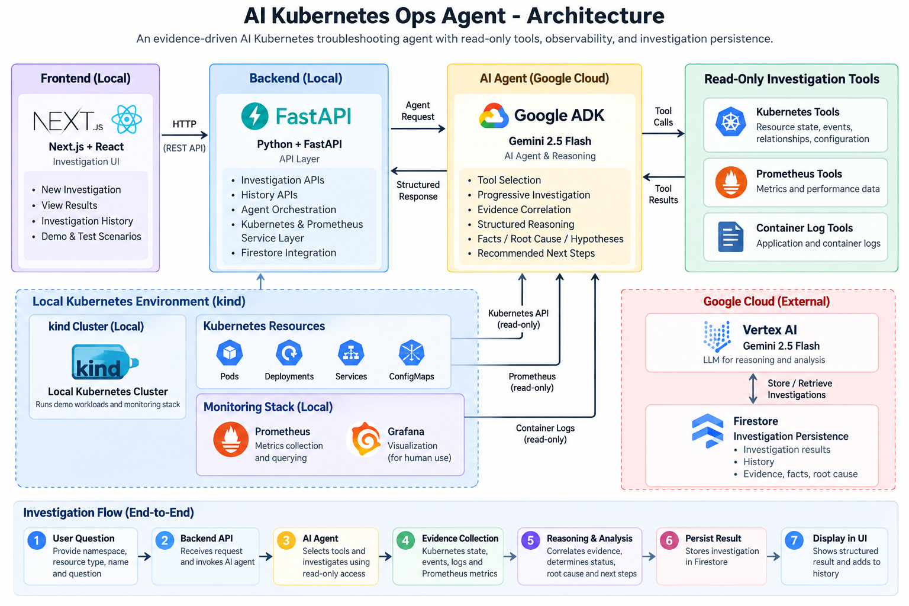
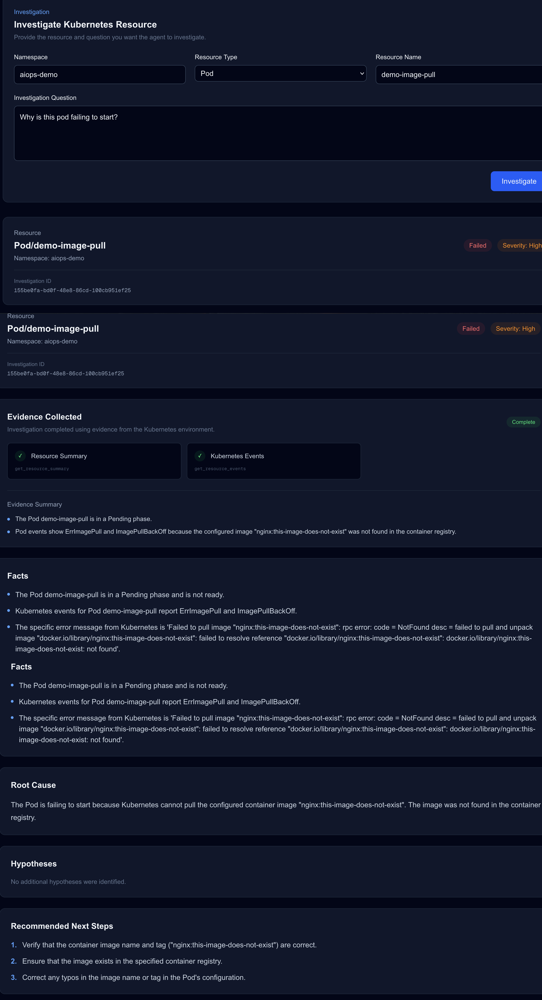
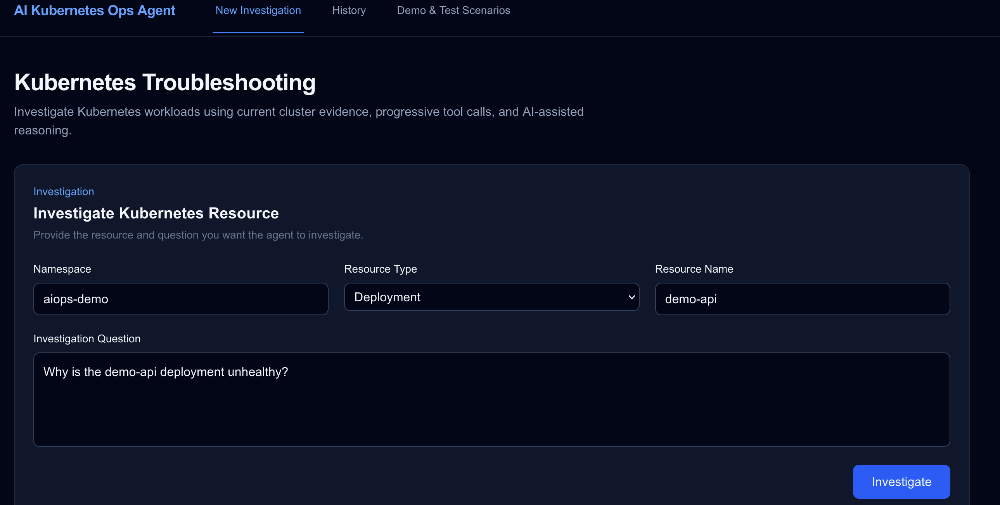
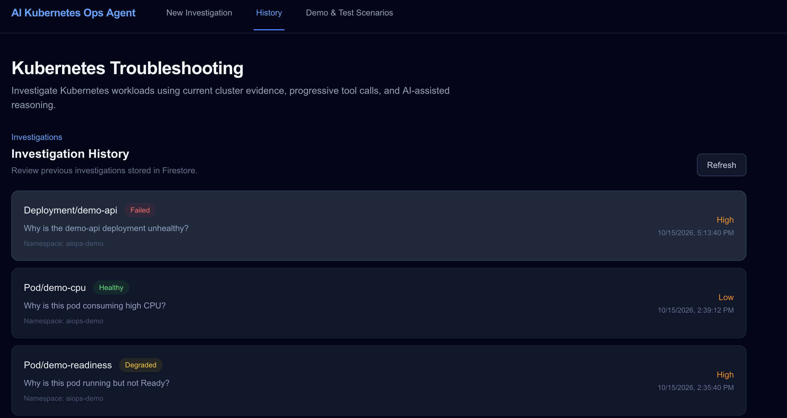
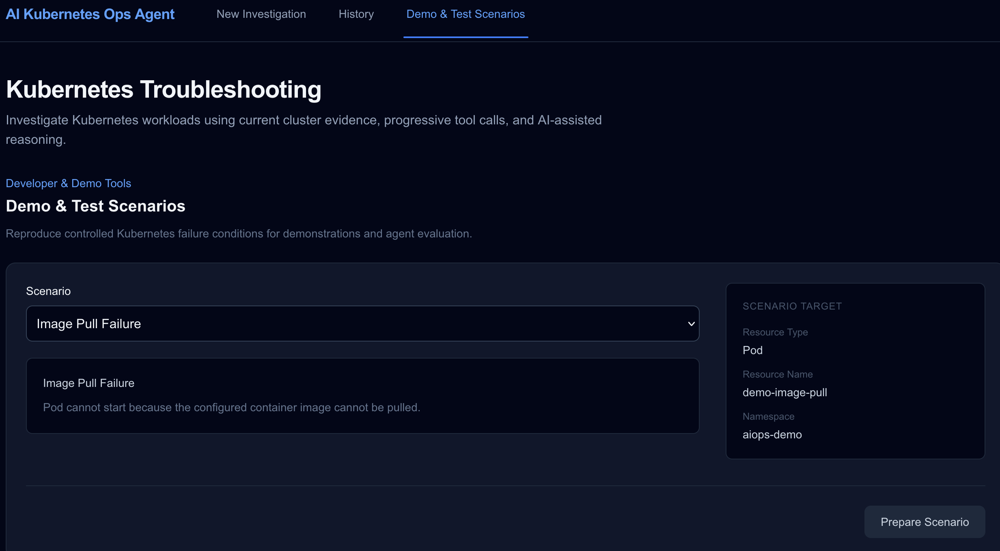

# AI Kubernetes Ops Agent

An evidence-driven AI Kubernetes troubleshooting agent that investigates workload failures by progressively collecting read-only Kubernetes, Prometheus, and container-log evidence and using Gemini to reason over the observed state.

The project combines **Kubernetes troubleshooting, AI agent orchestration, observability, evidence-based reasoning, and investigation persistence** into a single platform-engineering workflow.

---

## Problem Statement

Kubernetes troubleshooting often requires engineers to manually correlate information from multiple sources:

- Pod status
- Deployment and ReplicaSet relationships
- Kubernetes events
- Container lifecycle state
- Container logs
- Readiness and liveness probes
- Resource requests and limits
- Prometheus metrics
- Service selectors and endpoints

For example, a Deployment may appear unhealthy, but the actual failure could be several layers below it:

    Deployment
        ↓
    ReplicaSet
        ↓
    Pod
        ↓
    Container
        ↓
    Image / Probe / Resource / Application failure

The objective of this project is to build an AI-assisted troubleshooting system that can perform this investigation systematically rather than simply generating a natural-language guess.

---

# Solution Overview

The AI Kubernetes Ops Agent:

1. Accepts a Kubernetes troubleshooting question.
2. Identifies the target resource and namespace.
3. Uses controlled, read-only Kubernetes investigation tools.
4. Progressively gathers evidence based on the current findings.
5. Correlates Kubernetes state, events, logs, and Prometheus metrics.
6. Separates confirmed facts from hypotheses.
7. Produces a structured investigation result.
8. Persists the investigation in Firestore.
9. Allows previous investigations to be reviewed from the UI.

The agent is intentionally designed around:

> **Evidence before explanation.**

The AI does not treat an LLM-generated explanation as a fact unless the available infrastructure evidence supports it.

---

# Architecture

---

## Screenshots

### Investigation Result

### New Investigation

### Investigation History

### Demo & Test Scenarios

---

# Investigation Flow

A typical investigation follows a progressive evidence-gathering strategy.

    User Question
          │
          ▼
    Resource Context
          │
          ▼
    Resource Summary
          │
          ▼
    Identify Failure Signal
          │
          ├──────────────────┐
          ▼                  ▼
    Kubernetes Events    Resource Relationships
          │                  │
          └────────┬─────────┘
                   ▼
          Deeper Investigation
                   │
          ┌────────┼────────┐
          ▼        ▼        ▼
        Logs     Metrics  Configuration
          │        │        │
          └────────┼────────┘
                   ▼
          Evidence Correlation
                   │
                   ▼
          Structured Diagnosis
                   │
          ┌────────┼──────────────┐
          ▼        ▼              ▼
        Facts   Root Cause    Hypotheses
                   │
                   ▼
          Recommended Steps
                   │
                   ▼
              Firestore

The agent does not blindly call every tool for every investigation.

It uses a **progressive investigation strategy**, starting with high-value evidence and going deeper when required.

---

# AI Agent Design

The agent is implemented using **Google ADK** with **Gemini 2.5 Flash**.

The agent is given a controlled set of tools rather than unrestricted access to the Kubernetes environment.

## Agent Capabilities

The agent can investigate:

- Deployments
- ReplicaSets
- Pods
- Services
- Container state
- Kubernetes events
- Pod configuration
- Container logs
- Prometheus metrics
- Resource relationships

The agent is strictly **read-only**.

It cannot:

- Delete Pods
- Restart workloads
- Modify Deployments
- Change container images
- Scale workloads
- Modify Services
- Apply Kubernetes manifests
- Execute arbitrary cluster commands

This separation is intentional.

The AI agent is responsible for **investigation and reasoning**, while remediation remains outside the current scope.

---

# Evidence-Based Reasoning

A central design principle of the project is:

> **Evidence first, explanation second.**

The investigation response separates confirmed observations from reasoning.

## Facts

Facts are directly observed evidence.

Example:

    The Pod is in Pending phase.

    Kubernetes events show:
    Back-off pulling image "nginx:this-image-does-not-exist".

    Kubernetes events show:
    Error: ImagePullBackOff.

## Root Cause

The root cause is the strongest explanation supported by the available evidence.

Example:

    The Pod is unavailable because Kubernetes cannot pull
    the configured container image
    "nginx:this-image-does-not-exist".

## Hypotheses

Hypotheses represent potential explanations that are not directly established.

Example:

    []

When the evidence establishes the cause directly, the agent should not invent additional hypotheses.

This distinction is important because infrastructure troubleshooting requires a clear separation between:

    Observed
       ↓
    Supported conclusion
       ↓
    Potential explanation

---

# Assessment Model

Each investigation produces one operational status:

| Status | Meaning |
|---|---|
| `Healthy` | Resource is functioning normally |
| `Degraded` | Resource is operational but has confirmed impairment, instability, partial availability, or performance issues |
| `Failed` | Confirmed failure prevents the workload/resource from starting or performing its intended function |

Severity is evaluated independently from operational status.

For example:

    Status: Degraded
    Severity: Medium

can represent an operational workload experiencing confirmed performance degradation.

Similarly:

    Status: Failed
    Severity: High

can represent a workload that cannot start because its container image cannot be pulled.

---

# Kubernetes Investigation Tools

The agent currently has access to controlled, read-only tools.

| Tool | Purpose |
|---|---|
| `get_resource_summary` | Basic resource health and state |
| `get_resource_events` | Kubernetes events associated with the resource |
| `get_resource_relationships` | Deployment → ReplicaSet → Pod relationships |
| `get_pod_container_status` | Container lifecycle and restart information |
| `get_pod_configuration` | Images, probes, resources, ports, commands and arguments |
| `get_pod_metrics` | Prometheus metrics |
| `get_container_logs` | Container/application logs |
| `investigate_resource` | Deeper resource investigation |

The tool layer is separated from the AI reasoning layer.

    AI Agent
       │
       ▼
    Agent Tool Wrappers
       │
       ▼
    Investigation Services
       │
       ├── Kubernetes
       ├── Prometheus
       └── Container Logs

This makes the infrastructure access layer independently testable and keeps Kubernetes access under explicit application control.

---

# Important Reasoning Guards

The agent includes reasoning rules designed to avoid common AI troubleshooting mistakes.

## Image Pull Failures

If Kubernetes directly reports:

    ErrImagePull
    ImagePullBackOff
    Back-off pulling image

the agent treats the image-pull failure as a confirmed operational failure.

For example:

    Deployment
        ↓
    ReplicaSet
        ↓
    Pod
        ↓
    ImagePullBackOff
        ↓
    Configured image cannot be pulled

The agent does not invent unrelated causes when Kubernetes has already provided direct evidence.

---

## CrashLoopBackOff

The agent distinguishes:

    Container is repeatedly restarting

from:

    Why the application is exiting

Container state, previous termination information, restart counts, and logs are used to determine whether the immediate failure is known.

If the underlying application cause cannot be established from the available evidence, the agent explicitly states that it is not established.

---

## Readiness vs Liveness

The agent distinguishes readiness failures from liveness failures.

### Readiness

A container can be running while Kubernetes considers the Pod not ready to receive traffic.

    Container Running
            +
    Readiness Failed

This is treated as an operational degradation rather than automatically as a complete workload failure.

### Liveness

A failing liveness probe can cause Kubernetes to terminate and restart a container.

This is different from an application process crashing by itself.

The investigation correlates:

- Probe configuration
- Kubernetes events
- Container lifecycle
- Restart count
- Application behavior

---

## Metrics Are Evidence, Not Explanations

The agent does not automatically translate:

    High CPU

into:

    CPU throttling

or:

    High memory

into:

    OOMKilled

unless additional evidence supports those conclusions.

Similarly:

    Container restarted

does not automatically prove:

    Application error

Metrics and Kubernetes state are treated as evidence that must be correlated with other signals.

---

## Kubernetes Relationship Reasoning

For workloads such as Deployments, the agent correlates:

    Deployment
        ↓
    ReplicaSet
        ↓
    Pod
        ↓
    Container

ReplicaSet names or hashes alone are not treated as proof that one ReplicaSet is older or newer than another.

Relationship and ownership evidence are used instead.

---

# Failure Scenarios

The project includes controlled Kubernetes scenarios that can be reproduced locally.

These scenarios are useful for both demonstrations and deterministic evaluation.

## ImagePullBackOff

A workload is configured with an invalid image:

    nginx:this-image-does-not-exist

Expected investigation:

    Failed
       ↓
    ImagePullBackOff
       ↓
    Configured image cannot be pulled

---

## CrashLoopBackOff

A container intentionally exits with a failure code.

The agent correlates:

- Container state
- Restart count
- Termination information
- Application logs

The investigation distinguishes the observed restart behavior from any deeper cause that is not directly established.

---

## Pending Pod

A Pod is configured with resource requirements that cannot be scheduled on the available cluster capacity.

The investigation focuses on:

- Pod phase
- Scheduling events
- Resource requirements

---

## OOMKilled

A container exceeds its configured memory limit.

The agent correlates:

- Container termination state
- Exit reason
- Memory limits
- Restart information

---

## Readiness Probe Failure

A Pod is running but its readiness probe fails.

The investigation distinguishes:

    Container Running
            +
    Readiness Failed

from a complete container/application failure.

---

## Liveness Probe Failure

A failing liveness probe causes Kubernetes to restart the container.

The investigation correlates:

- Probe configuration
- Kubernetes events
- Container lifecycle
- Restart count

---

## Service Selector Mismatch

A Service selects labels that do not match the target Pods.

The investigation identifies the absence of matching endpoints instead of incorrectly blaming the application container.

---

## CPU Usage

A controlled CPU workload generates elevated Prometheus CPU usage.

The agent treats CPU utilization as evidence of resource pressure without automatically claiming CPU throttling unless additional evidence supports that conclusion.

---

# Observability

Prometheus is used as an additional evidence source.

Example metrics include:

    up
    kube_pod_info
    kube_pod_container_status_restarts_total

Prometheus is not used as a replacement for Kubernetes state.

Instead, it complements Kubernetes API information.

For example:

    Kubernetes:
    Container restarted

    +

    Prometheus:
    Restart count increased

    +

    Logs:
    Application emitted an error

    =

    Stronger investigation evidence

This multi-signal approach allows the agent to reason over infrastructure state rather than relying on a single signal.

---

# Investigation Persistence

Completed investigations are stored in Firestore.

Each investigation contains information such as:

    Investigation ID
    Created timestamp
    Question
    Resource
    Assessment
    Facts
    Root Cause
    Hypotheses
    Recommended Next Steps
    Investigation Evidence

This allows the application to support a complete investigation lifecycle:

    Investigate
        ↓
    Persist Result
        ↓
    Investigation History
        ↓
    Retrieve Previous Investigation
        ↓
    Review

Opening an existing investigation retrieves the stored result rather than triggering a new Gemini/Kubernetes investigation.

---

# Frontend

The frontend is implemented using:

- Next.js
- React
- TypeScript
- Tailwind CSS

The UI currently provides three main areas.

## New Investigation

Allows the user to specify:

- Namespace
- Resource type
- Resource name
- Investigation question

and execute an investigation.

The result displays:

- Resource
- Status
- Severity
- Investigation ID
- Evidence collected
- Facts
- Root cause
- Hypotheses
- Recommended next steps

---

## History

The History section displays previously persisted investigations.

Users can select a previous investigation and inspect the stored:

- Resource
- Status
- Severity
- Question
- Facts
- Root cause
- Hypotheses
- Recommended steps
- Evidence

Selecting a historical investigation retrieves it from the backend rather than re-running the AI investigation.

---

## Demo & Test Scenarios

The application provides controlled failure scenarios for demonstrations and testing.

This makes it possible to reproduce known Kubernetes failure conditions without manually modifying Kubernetes resources for every demonstration.

---

# Backend

The backend is implemented using:

- Python
- FastAPI
- Google ADK
- Vertex AI / Gemini
- Kubernetes Python client
- Prometheus
- Firestore

The main backend flow is:

    API Layer
        ↓
    Agent Service
        ↓
    Google ADK Agent
        ↓
    Agent Tools
        ↓
    Infrastructure Evidence

The backend also exposes investigation history APIs.

## Investigation API

`POST /investigate`

Starts a new investigation.

## Investigation History

`GET /investigations`

Returns recent investigations.

## Retrieve Investigation

`GET /investigations/{investigation_id}`

Returns a previously persisted investigation.

## Health

`GET /health`

Provides a basic backend health check.

---

# Testing & Evaluation

The project uses deterministic tests to validate important application and investigation behavior without depending entirely on live Gemini responses.

The test suite covers areas including:

- Investigation context preservation
- JSON response parsing
- Invalid AI response handling
- Schema validation
- Investigation service behavior
- Repository persistence behavior
- Evaluation logic
- Controlled investigation cases
- Investigation response structure

The deterministic evaluation suite currently passes:

    36 / 36 tests

The objective is not only to test whether the application runs, but also to test whether investigation responses follow the project's reasoning rules.

---

# Evaluation Philosophy

LLM applications can be difficult to test because model output is not deterministic.

Therefore, the project separates:

    Live AI Investigation
            │
            ▼
    Structured Investigation Response
            │
            ▼
    Deterministic Evaluation

The evaluation layer checks whether an investigation response contains evidence-supported conclusions rather than relying on one exact natural-language answer.

This allows important reasoning behavior to be evaluated independently from the exact wording produced by Gemini.

---

# Security & Safety Boundaries

The agent is intentionally restricted to read-only investigation.

The current security boundary is:

    User
      │
      ▼
    FastAPI
      │
      ▼
    AI Agent
      │
      ▼
    Read-only Tools
      │
      ▼
    Kubernetes / Prometheus

There is no AI-driven mutation path.

The agent cannot directly:

- Delete workloads
- Restart Pods
- Modify Deployments
- Scale workloads
- Change images
- Modify Services
- Apply Kubernetes manifests

This prevents the LLM from directly performing potentially destructive Kubernetes operations.

---

## Remediation Boundary

The current project separates:

    AI
     ↓
    Investigation
     ↓
    Evidence
     ↓
    Recommendation
     ↓
    Human Decision

from:

    Kubernetes Mutation

Automated remediation is intentionally outside the current scope.

A future remediation workflow should require explicit approval and additional safety controls.

---

# Local Development Architecture

The application is designed to run locally.

    macOS
     │
     ├── Next.js
     │     localhost:3000
     │
     ├── FastAPI
     │     localhost:8000
     │
     └── kind
           │
           ├── Kubernetes workloads
           ├── Prometheus
           └── Grafana

Vertex AI / Gemini is accessed through Google Cloud.

Firestore is used for investigation persistence.

The application itself does not need to be deployed into the user's GCP environment.

This architecture provides a controlled environment where Kubernetes failure scenarios can be reproduced safely.

---

# Prerequisites

Install:

- Python 3
- Node.js
- npm
- Docker
- kind
- kubectl
- Helm
- Google Cloud CLI

You also need access to:

- A Google Cloud project
- Vertex AI
- Firestore

---

# Backend Setup

Create and activate a Python virtual environment:

    cd backend

    python3 -m venv .venv
    source .venv/bin/activate

Install dependencies:

    pip install -r requirements.txt

Authenticate with Google Cloud:

    gcloud auth application-default login

Configure the Google Cloud project:

    gcloud config set project <PROJECT_ID>

Configure the Vertex AI environment variables in:

    backend/app/agents/.env

Example:

    GOOGLE_GENAI_USE_VERTEXAI=TRUE
    GOOGLE_CLOUD_PROJECT=<PROJECT_ID>
    GOOGLE_CLOUD_LOCATION=europe-west3

Start the backend:

    uvicorn app.main:app --reload --port 8000

Verify the backend:

    curl http://127.0.0.1:8000/health

Expected response:

    {
      "status": "healthy",
      "service": "ai-kubernetes-ops-agent"
    }

---

# Frontend Setup

From the project root:

    cd frontend
    npm install
    npm run dev

Open:

    http://localhost:3000

---

# Kubernetes Environment

Create a local kind cluster:

    kind create cluster

Verify the cluster:

    kubectl get nodes

Deploy the demo workloads:

    kubectl apply -f k8s/demo/

Verify:

    kubectl get pods -n aiops-demo

---

# Prometheus & Grafana

The project uses Prometheus for metrics used during investigations.

Verify the monitoring stack:

    kubectl get pods -n monitoring

Prometheus can be accessed locally using port forwarding:

    kubectl port-forward -n monitoring svc/prometheus-operated 9090:9090

Grafana can similarly be exposed locally for visualization.

Grafana is primarily used for human observability, while Prometheus is queried by the investigation system for machine-readable evidence.

---

# Running Tests

From the backend directory:

    cd backend

Run the complete test suite:

    python3 -m unittest discover -s tests -v

The project includes deterministic tests for:

- Agent service behavior
- Response parsing
- Investigation models
- Repository behavior
- Evidence evaluation
- Controlled investigation scenarios

---

# Demo Walkthrough

A simple portfolio demonstration can use the ImagePullBackOff scenario.

## Step 1 — Start the Application

Run:

    FastAPI
    +
    Next.js
    +
    kind
    +
    Prometheus

---

## Step 2 — Prepare a Failure Scenario

Open:

    Demo & Test Scenarios

Select the desired Kubernetes failure scenario.

---

## Step 3 — Open the Investigation

Navigate to:

    New Investigation

For example:

    Namespace:
    aiops-demo

    Resource Type:
    Deployment

    Resource Name:
    demo-api

    Question:
    Why is the demo-api deployment unhealthy?

---

## Step 4 — Agent Investigation

The agent progressively investigates the workload.

For an image-pull failure, the evidence chain can look like:

    Deployment
       ↓
    ReplicaSet
       ↓
    Pod
       ↓
    Pending
       ↓
    ImagePullBackOff
       ↓
    Back-off pulling image
       ↓
    Invalid configured image

---

## Step 5 — Structured Diagnosis

The agent produces a structured result such as:

    Status:
    Failed

    Severity:
    High

    Facts:
    - Pod is Pending
    - Pod is not Ready
    - ImagePullBackOff observed
    - Kubernetes reports back-off pulling the configured image

    Root Cause:
    Configured container image cannot be pulled

    Hypotheses:
    None

---

## Step 6 — Persistence

The completed investigation is stored in Firestore.

An investigation ID is returned to the frontend.

---

## Step 7 — Investigation History

Open:

    History

Select the previous investigation.

The frontend retrieves:

    GET /investigations/{investigation_id}

and displays the persisted investigation.

The historical investigation does not trigger another AI/Kubernetes investigation.

---

# Project Structure

    ai-kubernetes-ops-agent/
    │
    ├── backend/
    │   ├── app/
    │   │   ├── agents/
    │   │   │   ├── kubernetes_agent.py
    │   │   │   └── tools.py
    │   │   │
    │   │   ├── api/
    │   │   │   └── models.py
    │   │   │
    │   │   ├── repositories/
    │   │   │   ├── investigation_repository.py
    │   │   │   └── firestore_investigation_repository.py
    │   │   │
    │   │   ├── services/
    │   │   │   ├── agent_service.py
    │   │   │   ├── investigation.py
    │   │   │   └── evidence.py
    │   │   │
    │   │   ├── tools/
    │   │   │   ├── kubernetes.py
    │   │   │   └── pod_configuration.py
    │   │   │
    │   │   └── main.py
    │   │
    │   └── tests/
    │
    ├── frontend/
    │   └── app/
    │       └── page.tsx
    │
    ├── k8s/
    │   ├── demo/
    │   └── monitoring/
    │
    ├── docs/
    │
    ├── .gitignore
    └── README.md

---

# Key Design Decisions

## Why Google ADK?

Google ADK provides an agent-oriented framework for defining:

- Agents
- Tools
- Structured outputs
- Model interaction
- Tool-driven investigation workflows

The project uses ADK to keep AI orchestration separate from the Kubernetes infrastructure layer.

---

## Why Gemini?

Gemini provides the reasoning layer required to correlate multiple infrastructure signals and produce a structured troubleshooting explanation.

The model is not treated as the source of truth.

Infrastructure systems remain the source of evidence.

    Kubernetes / Prometheus / Logs
                ↓
             Evidence
                ↓
              Gemini
                ↓
           Explanation

---

## Why Read-Only Tools?

An AI system that can directly modify a Kubernetes cluster introduces significant operational risk.

The current project therefore establishes a clear boundary:

    AI = Investigation

    Infrastructure = Source of Truth

    Human = Remediation Decision

This makes the system safer to demonstrate and easier to reason about operationally.

---

## Why Prometheus?

Kubernetes API state provides information about current resource state and lifecycle.

Prometheus provides a complementary view of operational behavior and metrics.

Combining the two gives the investigation more context than either source alone.

---

## Why Firestore?

Firestore provides a simple persistence layer for investigation results without requiring the application to manage a traditional relational database.

It also demonstrates a complete investigation lifecycle:

    Investigate
        ↓
    Persist
        ↓
    Retrieve
        ↓
    Review

---

## Why kind?

The project uses a local kind cluster to provide:

- Full control over the Kubernetes environment
- Reproducible failure scenarios
- Safe experimentation
- No dependency on a production cluster
- Easy demonstration of failure conditions

This is particularly useful for an AI troubleshooting system because controlled failures can be introduced intentionally.

---

# Future Enhancements

The following capabilities are intentionally outside the current implementation and can be considered future enhancements.

## Human-Approved Remediation

A future workflow could look like:

    Investigation
         ↓
    Recommended Remediation
         ↓
    Human Approval
         ↓
    Controlled Kubernetes Action
         ↓
    Verification

The important principle would be that remediation is not automatically performed simply because the AI suggested it.

---

## Additional Observability Sources

Potential integrations include:

- Loki
- OpenTelemetry
- Alertmanager
- Cloud Logging
- Cloud Monitoring

---

## Multi-Cluster Investigation

The agent could eventually support multiple Kubernetes clusters with explicit cluster context and access boundaries.

    Cluster A
    Cluster B
    Cluster C

---

## Investigation Comparison

Historical investigations could be compared to identify recurring operational problems.

    Investigation 1
          ↓
    Investigation 2
          ↓
    Investigation 3
          ↓
    Recurring Pattern

---

## Automated Incident Reports

The agent could generate structured incident reports containing:

- Timeline
- Impact
- Evidence
- Root cause
- Contributing factors
- Recommended remediation
- Verification steps

---

# Project Goals

This project is designed to demonstrate practical engineering across:

- Kubernetes
- Cloud infrastructure
- Platform engineering
- Observability
- Python
- FastAPI
- Google ADK
- Gemini
- Prometheus
- Firestore
- API design
- AI agent architecture
- Infrastructure troubleshooting
- Automated testing
- AI evaluation
- Security boundaries
- Evidence-driven engineering

The primary goal is not to build another Kubernetes chatbot.

The goal is to demonstrate how:

> **AI reasoning can be safely combined with infrastructure evidence to assist Kubernetes troubleshooting without giving the AI uncontrolled access to production systems.**

---

# Current Status

The core investigation workflow is implemented and tested.

Current capabilities include:

- Read-only Kubernetes investigation
- Deployment → ReplicaSet → Pod relationship analysis
- Kubernetes event analysis
- Container lifecycle analysis
- Probe investigation
- Container log analysis
- Prometheus metrics
- Evidence-based reasoning
- Structured investigation responses
- Controlled Kubernetes failure scenarios
- Deterministic evaluation
- Firestore investigation persistence
- Investigation history
- Next.js investigation UI

The current deterministic evaluation suite passes:

    36 / 36 tests

---

# License

This project is intended as a personal portfolio and learning project.